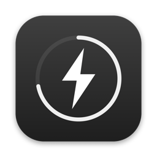
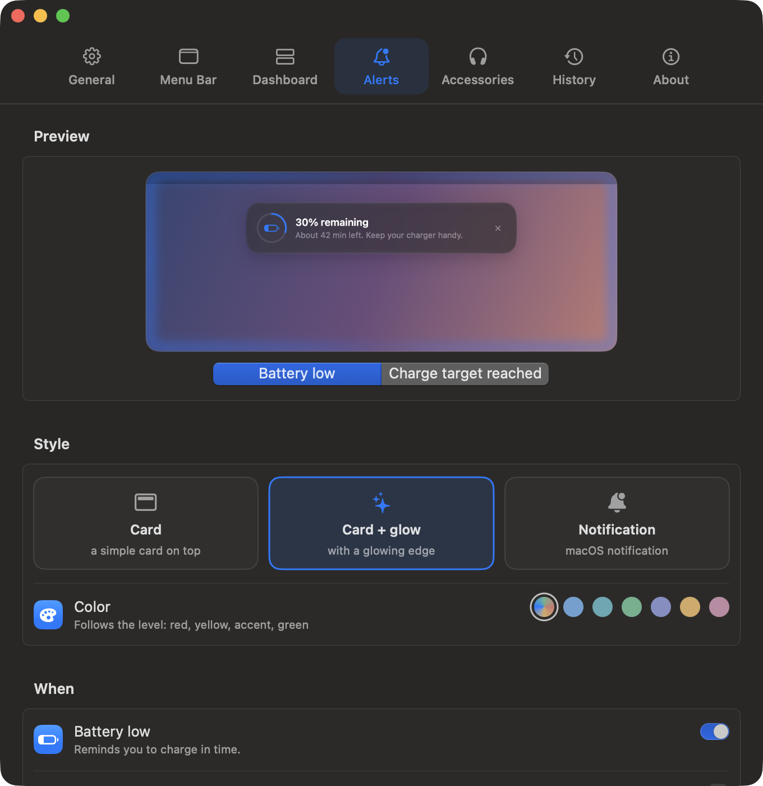
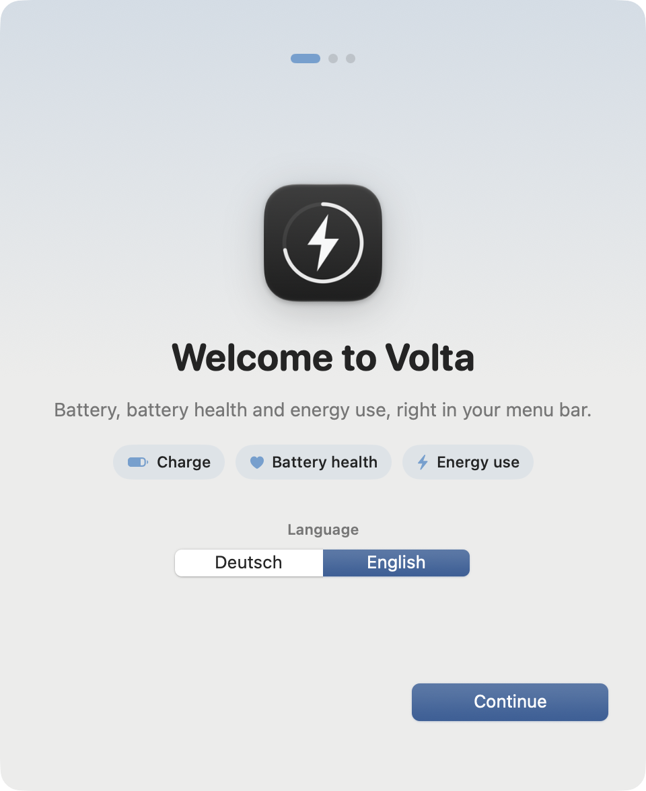
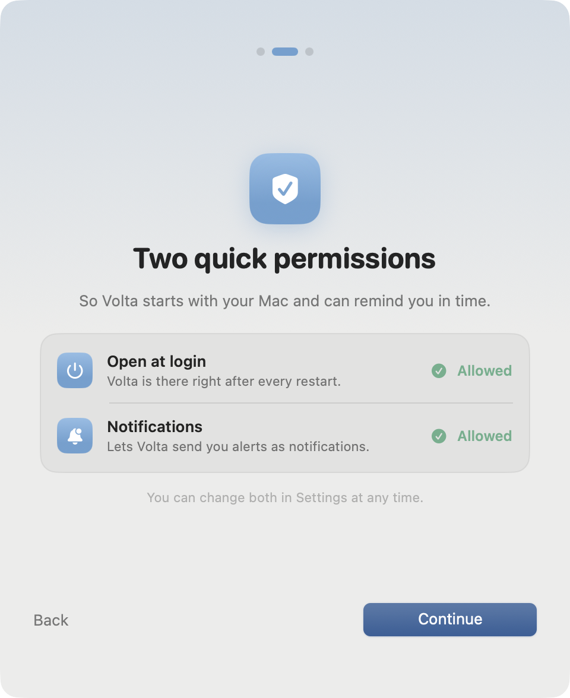
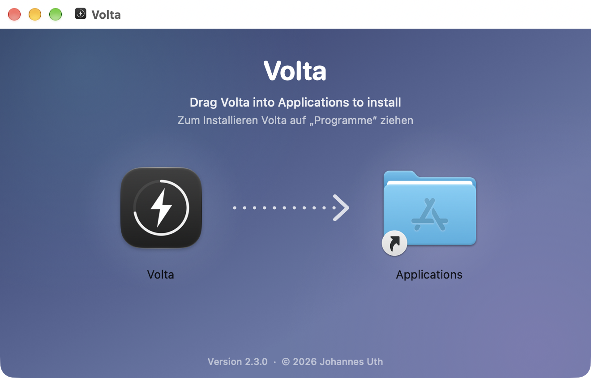

<div align="center">



# Volta

**Battery, health and energy use, right in the macOS menu bar.**

[](https://github.com/johannesuth/volta/releases/latest)


English · Deutsch · free · no account · everything stays on your Mac

</div>

<p align="center">
  
  &nbsp;
  
</p>

## Why Volta

The macOS battery menu tells you a percentage. Volta tells you the rest: how long the charge will last and until what time, how healthy the battery is, which apps use the most energy and how your day of charging and discharging looked, in one calm panel that opens from the menu bar.

## Features

- **A menu-bar battery in color.** Light green above 50 %, light yellow from 21 to 50 %, light red at 20 % or less, with a sharp dark number like the macOS battery. Accent-color and monochrome styles are available, and if you prefer a quiet menu bar, Volta can show just its logo.
- **The dashboard at a glance.** Charge and time remaining, including the clock time (“until about 5:11 PM”). Battery health with maximum capacity, charge cycles and temperature. The apps using the most energy, shown as a simple share in percent.
- **A history chart that reads itself.** Battery phases in blue, charging in green, over 6 hours, 24 hours or 7 days. Below it: average discharge per hour and the expected runtime on a full charge.
- **Alerts you can preview.** A reminder when the battery runs low and a notice when your charge target is reached. Pick a card, a card with a glowing screen edge, or a real macOS notification that also lands in Notification Center. The color follows the charge level or uses one of six calm colors, and Settings shows a live preview of every change. Cards stay for five seconds, then fade out on their own.
- **Accessories.** Battery levels of AirPods, mice and keyboards when macOS reports them, with an optional low-battery alert.
- **Everyday settings that work.** Open at login (listed as “Volta” in Login Items), a global shortcut (⌃⌥V by default), Automatic, Light or Dark appearance, an accent color, °C or °F, and a pinned dashboard that stays open while you work.
- **Light on your battery.** While the dashboard is closed, Volta reacts to battery changes macOS reports and otherwise checks once a minute: about 0.02 % CPU and around 35 MB of memory.
- **Private by design.** Volta reads battery data from macOS and stores its history in `~/Library/Application Support/Volta`. It makes no network connections, needs no account and sends no analytics.

Advanced extras are off by default: power flow (adapter, battery and system watts) and technical battery values (mAh, voltage, current).

## First start

A short setup in three steps: pick English or German, allow **Open at login** and **Notifications**, done. Volta appears in the menu bar once setup is finished. Everything can be changed later in Settings.

<p align="center">
  
  &nbsp;
  
</p>

## Install



1. Download **Volta-2.4.1.dmg** from the [latest release](https://github.com/johannesuth/volta/releases/latest).
2. Open it and drag **Volta** onto **Applications**.
3. Eject the **Volta** disk: click ⏏ next to it in the Finder sidebar, or drag it to the Trash.
4. Open Volta from your Applications folder.

Requires macOS 15 or later on Apple silicon or Intel.

<br clear="right" />

> [!NOTE]
> **First open.** Volta is not notarized by Apple yet, so macOS asks for confirmation the first time:
> 1. Open Volta. When macOS says it cannot verify the app, click **Done**.
> 2. Open **System Settings → Privacy & Security**, scroll down and click **Open Anyway** next to “Volta”.
> 3. Confirm with your password or Touch ID.
>
> This is Apple's standard way to open apps from outside the App Store and is only needed once. Once releases are signed with a Developer ID and notarized, macOS will only show its usual “downloaded from the Internet” confirmation.

**Homebrew** (available once a notarized release is published):

```sh
brew tap johannesuth/volta
brew install --cask volta
```

**Uninstall:** right-click the menu-bar battery and choose **Quit Volta**, move it from Applications to the Trash and, if you like, delete `~/Library/Application Support/Volta`.

## Usage

| | |
|---|---|
| Open the dashboard | Click the menu-bar battery or press ⌃⌥V |
| Open Settings | Gear icon in the dashboard, or right-click the menu-bar battery |
| Expand or collapse a section | Click its title |
| Keep the dashboard open | Pin icon in the dashboard |
| Change the chart range | 6 h · 24 h · 7 days above the chart |
| Try an alert | Settings → Alerts → Test alert now |

Volta also responds to `volta://open`, `volta://close` and `volta://preferences`, for example from Shortcuts or a terminal: `open volta://open`.

## Build from source

You need macOS 15 or later and Xcode.

```sh
git clone https://github.com/johannesuth/volta.git
cd volta
export DEVELOPER_DIR=/Applications/Xcode.app/Contents/Developer
swift test                          # 88 unit tests
./Scripts/build-app.sh              # build/Volta.app and dist/Volta-<version>.dmg
./Scripts/build-app.sh --install    # also replaces /Applications/Volta.app and starts it
```

Building is allowed for your own use; see [License](#license).

```text
Sources/Volta/               app, dashboard, settings, alerts, menu-bar icon
Sources/VoltaLanguageCore/   language, profiles and setup logic
Tests/                       unit tests, including pixel tests of the menu-bar icon
Resources/                   English and German strings
Scripts/                     app, icon and disk-image builds, signing and notarization
Casks/volta.rb               Homebrew Cask
docs/                        release notes and screenshots
```

## Releasing

For the maintainer. Requires a paid Apple Developer Program membership.

1. Install a **Developer ID Application** certificate and store notarization credentials once with `xcrun notarytool store-credentials VoltaNotary`. Never commit certificates or credentials.
2. Build, sign, notarize and staple the app and the disk image:

   ```sh
   export VOLTA_SIGN_IDENTITY='Developer ID Application: Johannes Uth (TEAMID)'
   export VOLTA_NOTARY_PROFILE='VoltaNotary'
   ./Scripts/sign-notarize.sh
   ```

3. Put the printed SHA-256 into `Casks/volta.rb`.
4. Publish:

   ```sh
   git tag v2.4.1 && git push origin v2.4.1
   gh release create v2.4.1 dist/Volta-2.4.1.dmg dist/SHA256SUMS.txt \
     --title 'Volta 2.4.1' --notes-file docs/releases/2.4.1.md
   ```

See [CHANGELOG.md](CHANGELOG.md) for the version history.

## License

**Free to use · source available · © 2026 Johannes Uth. All rights reserved.**

Volta is free, and its source code is public so anyone can see how it works. The code, design and artwork are still protected by copyright.

| ✅ You may | ❌ You may not, without written permission |
|---|---|
| Download and use Volta for free, privately or at work | Copy or republish the source code |
| Read the code and build it for yourself | Publish modified versions or apps based on Volta |
| Share links to this repository and its releases | Sell Volta or distribute it anywhere else |
| Report bugs and suggest ideas in [Issues](https://github.com/johannesuth/volta/issues) | Remove or change copyright notices |

The full terms are in [LICENSE](LICENSE). Volta is *source-available* software, not open source in the OSI sense.
