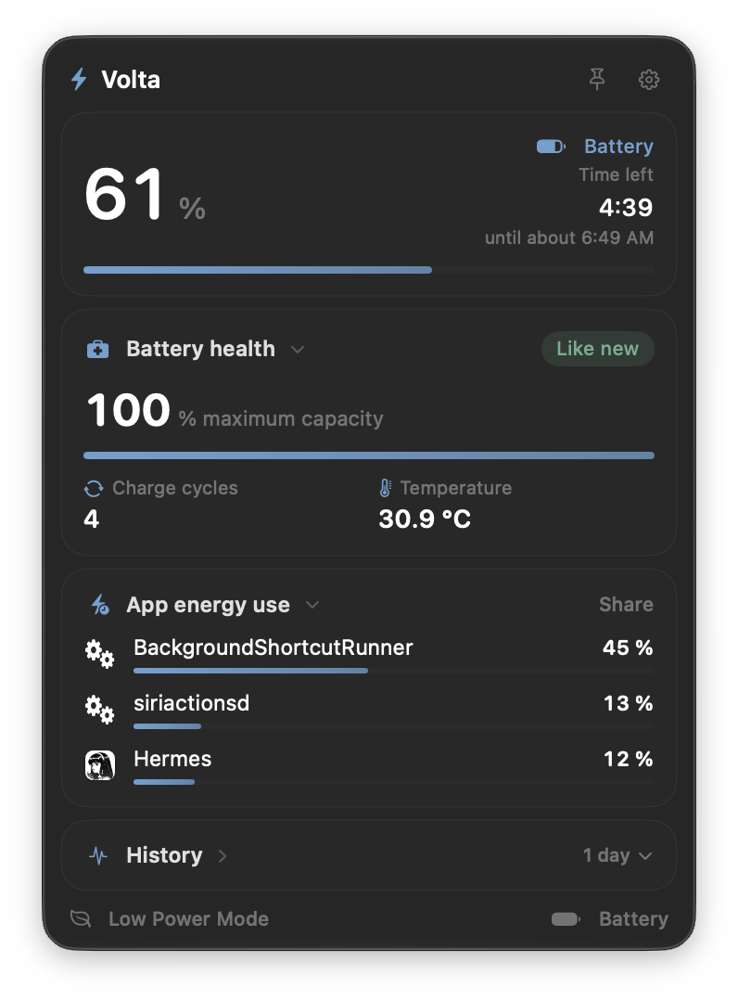
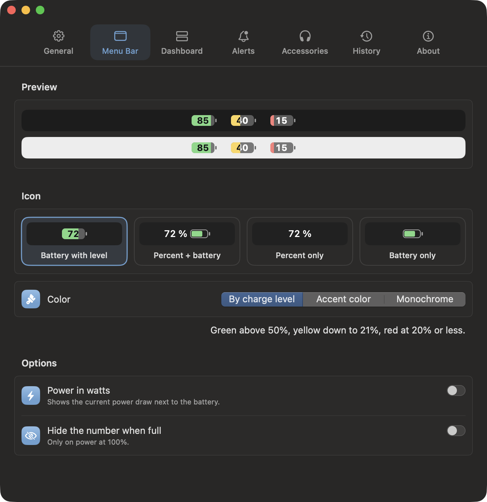

<div align="center">


# Volta

**Battery, health and energy use, right in the macOS menu bar.**

Native · on-device · English and German

</div>

> [!IMPORTANT]
> **Not notarized yet.** Volta 2.2.0 (build 27) is ad-hoc signed for local development and the `.pkg` is unsigned. A Developer ID signature and Apple notarization are required before it opens on other Macs without a Gatekeeper warning. Nothing in this repository bypasses Gatekeeper.

<p align="center">
  
  
</p>

## Features

- **Menu-bar battery in color.** Light green above 50 %, light yellow from 21 to 50 %, light red at 20 % or less, with a large, sharp number. Accent and monochrome styles are available.
- **Dashboard at a glance.** Charge, time remaining with clock time, battery health (maximum capacity, charge cycles, temperature), the apps using the most energy as a simple percentage, and a charge history chart. You can open several sections at once, and the panel never scrolls.
- **Alerts.** A reminder when the battery runs low and a notice when your charge target is reached, as a card, a card with edge glow, or a system notification.
- **Accessories.** Battery levels of AirPods, mice and keyboards when macOS reports them.
- **Everyday settings that work.** Open at login (listed as “Volta” in Login Items), a global shortcut (⌃⌥V by default), Automatic/Light/Dark appearance and a pinned “keep open” dashboard.
- **Private.** All data stays on your Mac. No account, no cloud, no network needed for battery readings.
- **English and German.** Choose on first launch; change any time in Settings.

Advanced extras are off by default: power flow (adapter, battery and system watts) and technical battery values (mAh, voltage, current).

## Requirements

macOS 15 or later on Apple silicon or Intel (universal binary).

## Install

**From source**

```sh
git clone https://github.com/johannesuth/volta.git
cd volta
./Scripts/build-app.sh --install
```

The script builds a universal app, verifies its signature and creates a ZIP and an installer package in `dist/`. `--install` copies the app to `/Applications` (or `~/Applications` if that isn't writable) and keeps a backup of an existing copy.

**Homebrew** (after a signed release is published)

```sh
brew tap johannesuth/volta
brew install --cask volta
```

## Usage

| | |
|---|---|
| Open the dashboard | Click the menu-bar battery or press ⌃⌥V |
| Open Settings | Gear icon in the dashboard, or right-click the menu-bar battery |
| Expand or collapse a section | Click its title |
| Keep the dashboard open | Pin icon in the dashboard, or Settings → Dashboard → Keep open |

## Development

```sh
DEVELOPER_DIR=/Applications/Xcode.app/Contents/Developer swift test
```

53 tests cover settings defaults and migration, dashboard sections, alerts, login-item migration, appearance, energy-share labels, localization and pixel-level menu-bar rendering.

```text
Sources/Volta/               app and UI
Sources/VoltaLanguageCore/   language and onboarding logic
Tests/                       unit tests
Resources/                   German and English strings
Scripts/                     build, icon and signing scripts
Installer/                   per-user install helper
Casks/volta.rb               Homebrew Cask
docs/                        release notes and screenshots
```

## Releasing

1. Install a **Developer ID Application** and **Developer ID Installer** certificate and store notarization credentials with `xcrun notarytool store-credentials`. Never commit credentials.
2. Build, sign and notarize:

   ```sh
   export VOLTA_SIGN_IDENTITY='Developer ID Application: Johannes Uth (TEAMID)'
   export VOLTA_INSTALLER_IDENTITY='Developer ID Installer: Johannes Uth (TEAMID)'
   export VOLTA_NOTARY_PROFILE='VoltaNotary'
   ./Scripts/build-app.sh
   ./Scripts/sign-notarize.sh
   ```

3. Put the SHA-256 of the notarized ZIP into `Casks/volta.rb`.
4. Publish:

   ```sh
   git tag v2.2.0 && git push origin v2.2.0
   gh release create v2.2.0 dist/Volta-2.2.0-macos-universal.zip dist/Volta-2.2.0-installer.pkg \
     --title 'Volta 2.2.0' --notes-file docs/releases/2.2.0.md
   ```

See [CHANGELOG.md](CHANGELOG.md) for the version history.

## License

Copyright © 2026 Johannes Uth. All rights reserved. See [LICENSE](LICENSE).
