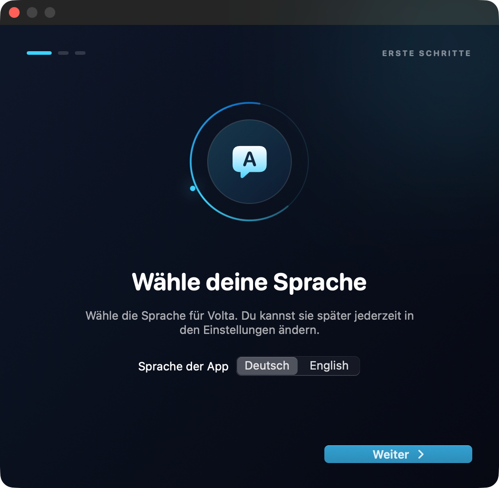
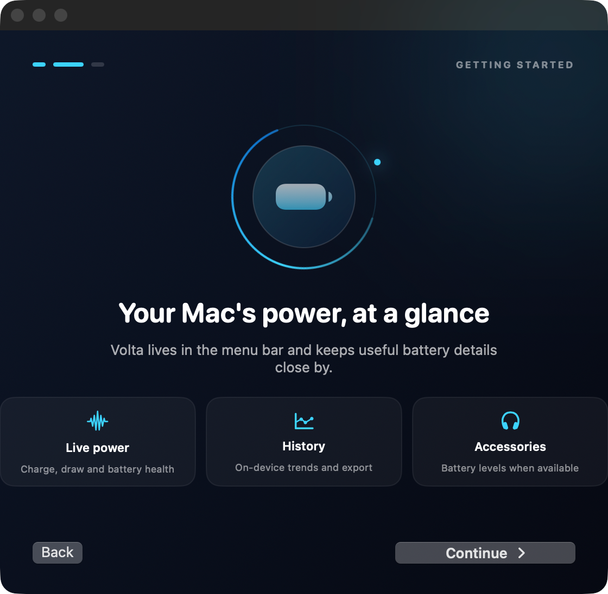

<div align="center">

# Volta

**Power and battery health, right from the macOS menu bar.**

A native, on-device utility for charge, power draw, battery history and connected accessories — in **English and German**.

</div>

> [!IMPORTANT]
> **Release status: prepared, not notarized.** Volta 2.1.5 (build 26) is locally ad-hoc signed for development, and the `.pkg` is unsigned. It is not yet a Gatekeeper-trusted public release. A valid Apple Developer ID certificate and Apple notarization are required before distributing a build that opens without a security warning. This repository does not bypass Gatekeeper or change macOS security settings.

## At a glance

| | |
|---|---|
| **Version** | 2.1.5 (build 26) |
| **Platform** | macOS 15 or later |
| **Architectures** | Apple silicon and Intel (universal binary) |
| **Languages** | Deutsch / English; selected on first launch and changeable in Settings |
| **Storage** | Local files in `~/Library/Application Support/Volta/` |
| **Network** | Not required for normal battery readings |
| **Copyright** | © 2026 Johannes Uth. All rights reserved. |

## Screenshots

<p align="center">
  
  
</p>

## Features

- A crisp, vector-drawn menu-bar battery with a large level figure, selectable icon colors, several styles and optional live power information.
- A compact, scroll-free dashboard with everyday battery information by default: charge level and time remaining, battery health (maximum capacity, charge cycles, temperature) and a collapsed history chart. Click any section title to expand or collapse it; several sections can be open at once, and the panel always fits on screen.
- Advanced extras are off by default and can be enabled in Settings: power flow, per-app energy use and technical battery values (mAh, voltage, current).
- Charge history, CSV export, and import from the macOS power log.
- Threshold alerts with optional sound, quiet hours, edge glow and notification cards.
- Battery levels for supported connected accessories, when reported by macOS.
- Appearance, accent, sampling intervals and optional dashboard sections are configurable; the dashboard size is fixed for a consistent, readable layout.
- A guided first-run setup with a language choice, animated steps and an optional welcome sound.
- The complete user-facing interface is localized in German and English.

Volta is an independent implementation. It does not contain code, assets or copied internal implementation details from other apps.

## Install

### Local installer

The Desktop release folder includes `Volta.app`, an installer package, and `Installer/Install Volta.command`.

- **`.pkg`:** installs Volta into `/Applications` and may request administrator approval. The current locally generated package is unsigned; do not treat it as a trusted public installer.
- **`Install Volta.command`:** installs Volta for the current user into `~/Applications/Volta.app`, without requiring administrator access. The script itself is unsigned and not notarized; treat it as a local development helper. For distribution, use the signed and notarized app/package from a release rather than bypassing Gatekeeper.
- **ZIP:** unzip `Volta-2.1.5-macos-universal.zip` and move `Volta.app` to Applications. The current ZIP contains an ad-hoc signed, non-notarized build.

The local installer is useful for development and testing. It cannot make an unsigned app trusted by other Macs.

### Homebrew (after a signed release is published)

The Cask is prepared in `Casks/volta.rb`. These commands become usable after the repository is published and the matching signed, notarized release asset is attached:

```sh
brew tap johannesuth/volta
brew install --cask volta
```

The Cask checksum must be updated to the final notarized ZIP before publishing a release. Do not publish the current ad-hoc artifact as a trusted Homebrew release.

### Build from source

Requirements: macOS 15+, Xcode with the macOS SDK, and SwiftPM.

```sh
git clone https://github.com/johannesuth/volta.git
cd volta
./Scripts/build-app.sh
open build/Volta.app
```

The build script compiles separate ARM64 and x86_64 release products, combines them into a universal app, verifies the bundle signature, and creates a ZIP plus an installer package under `dist/`.

For a local installation, after reviewing the script:

```sh
./Scripts/build-app.sh --install
```

This installs to `/Applications/Volta.app` when writable, otherwise to `~/Applications/Volta.app`. Existing app bundles are preserved as timestamped backups.

## First launch and everyday use

On first launch, choose **Deutsch** or **English**, review the short setup, and optionally enable the welcome sound. The language choice is saved locally and can be changed later.

- **Open the dashboard:** click the Volta menu-bar icon, or use the configured global shortcut.
- **Open Settings:** right-click the menu-bar icon and choose **Settings…**, or use **⌘,** from the dashboard.
- **Change language:** Settings → General → App language.
- **Adjust the menu-bar item:** Settings → Menu Bar.
- **Choose dashboard sections and content:** Settings → Dashboard. Battery health and history are on by default; power flow, app energy use and technical battery values are under **Advanced**.
- **Configure charge alerts and quiet hours:** Settings → Alerts.
- **Manage accessory visibility and order:** Settings → Accessories.
- **Export or clear history:** Settings → Data.

## Settings guide

| Section | What it controls |
|---|---|
| **General** | App language, login launch, global shortcut, sampling intervals, appearance, accent, temperature units, watt precision and reset. |
| **Menu Bar** | Icon style, charge percentage, power readout, accessory badges and when the number is hidden. |
| **Dashboard** | Keep-open behavior, sections (battery health, history, accessories), advanced extras (power flow, app energy use, technical battery values), chart range, app rows and accessory order. |
| **Alerts** | Low-charge and charge-target thresholds, visual presentation, sound, volume, notification delivery and quiet hours. |
| **Accessories** | Accessory scan interval, ordering, dashboard/menu-bar visibility and forgetting known devices. |
| **Data** | Default history range, retention, CSV export, macOS power-log import, clear-history action and storage folder. |
| **About** | Version, app summary and copyright. |

After clearing history, Volta keeps the cleared state across relaunch and does not automatically backfill old macOS power-log records. The explicit **Import from macOS power log** action remains available.

## Privacy and permissions

- Battery telemetry, history, preferences and custom sounds are stored locally; Volta has no account or cloud sync.
- Normal battery readings do not require network access or Bluetooth permission. Accessory data is read from the macOS system report when available.
- macOS may request notification permission if notifications are enabled.
- Changing Low Power Mode is performed only when requested and may require macOS administrator authorization.
- Login launch adds a per-user launch item; no privileged background service is installed.

## Signing and notarization

A public macOS app that should open without a Gatekeeper warning needs a **Developer ID Application** signature and Apple notarization. A signed `.pkg` additionally needs a **Developer ID Installer** identity. These are Apple-issued signing identities; an ad-hoc signature, self-signed certificate, installer script or Homebrew recipe cannot substitute for them.

1. Obtain the required Developer ID certificates in the macOS Keychain.
2. Store Apple notarization credentials locally with `xcrun notarytool store-credentials`; never commit credentials or paste them into this repository.
3. Set the identity and Keychain-profile names in your local shell, then run:

   ```sh
   export VOLTA_SIGN_IDENTITY='Developer ID Application: Your Name (TEAMID)'
   export VOLTA_INSTALLER_IDENTITY='Developer ID Installer: Your Name (TEAMID)'
   export VOLTA_NOTARY_PROFILE='VoltaNotary'
   ./Scripts/build-app.sh
   ./Scripts/sign-notarize.sh
   ```

4. Verify the notarized app and package, then update `Casks/volta.rb` with the SHA-256 of the final ZIP.
5. Attach the notarized ZIP and signed/notarized package to the GitHub release before publishing the Cask.

The signing script uses a Keychain profile and environment-variable names only; it does not store credentials in project files.

## GitHub release checklist

The source project is prepared for `johannesuth/volta` under the account `Johannes Uth` (`johannesuth`). The command below creates the remote and pushes the reviewed source; GitHub CLI will ask you to choose repository visibility:

```sh
gh repo create volta --description "Native macOS menu-bar app for battery charge, power flow, health and history" --source . --remote origin --push

# Only after Developer ID signing, notarization and checksum refresh:
git tag v2.1.5
gh release create v2.1.5 \
  dist/Volta-2.1.5-macos-universal.zip \
  dist/Volta-2.1.5-installer.pkg \
  --title 'Volta 2.1.5' \
  --notes-file docs/releases/2.1.5.md
```

Run the release commands only after signing, notarization, checksum refresh and final review. Verify the generated checksums in `dist/SHA256SUMS.txt`. The repository ignores generated build and distribution artifacts; attach the ZIP and package as GitHub Release assets, not as source files.

## Development and tests

```sh
DEVELOPER_DIR=/Applications/Xcode.app/Contents/Developer swift test
```

The tests cover language selection, settings defaults and migration, dashboard section behavior, URL handling, history-clear safety and pixel-level menu-bar rendering checks.

## Project layout

```text
Sources/Volta/                 macOS app and UI
Sources/VoltaLanguageCore/     testable language/onboarding logic
Tests/VoltaLanguageCoreTests/  language-core tests
Tests/VoltaAppTests/           app settings, dashboard and menu-bar rendering tests
Resources/de.lproj/            German strings and bundle metadata
Resources/en.lproj/            English strings and bundle metadata
Scripts/build-app.sh           universal app + ZIP + local installer package
Scripts/sign-notarize.sh       optional Developer ID signing/notarization
Installer/                     per-user installer command
Casks/volta.rb                 Homebrew Cask for signed releases
CHANGELOG.md                   versioned change history
.github/                       CI, issue templates and security guidance
docs/releases/                 prepared GitHub release notes
```

## Copyright

Copyright © 2026 Johannes Uth. All rights reserved. See [LICENSE](LICENSE).
